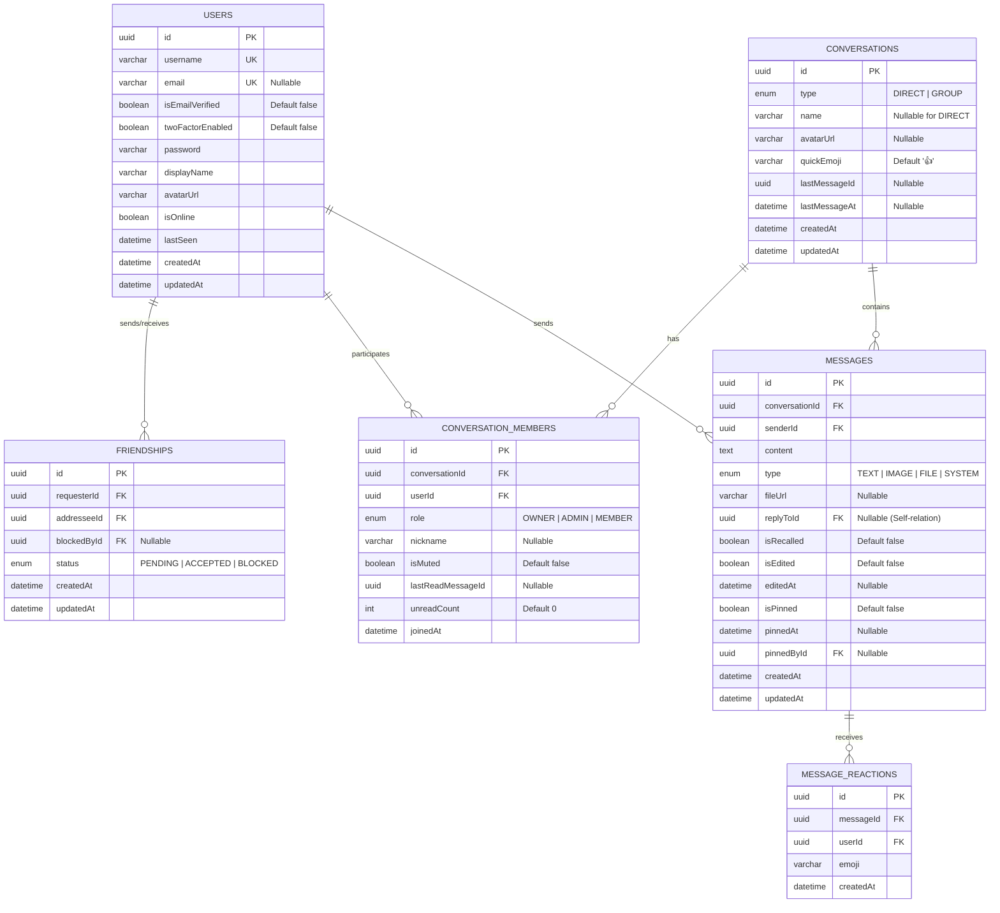

# SPEC.md — ReChat (Real-time Web Messenger)

**Version:** 3.2 · **Ngày:** 02/11/2026 · **Trạng thái:** [x] Approved

---

## 1. Tổng quan

Xây dựng ứng dụng web nhắn tin thời gian thực (**Real-time Web Messenger**) cho phép người dùng cá nhân kết bạn, trò chuyện trực tiếp 1-1 (**Direct Messaging**), tạo và quản lý nhóm trò chuyện (**Group Chat**) với trải nghiệm giao tiếp hiện đại: trạng thái trực tuyến (Online/Offline presence), hiển thị đang gõ (Typing indicator), trạng thái đã xem (Read receipts), và quản lý hộp thư (Inbox) với bộ đếm tin chưa đọc.

Hệ thống được nâng cấp toàn diện nền tảng bảo mật (**Next-Gen Security & Redis Engine**): Xác thực Email OTP, Đăng nhập linh hoạt (Username/Email), Quên và đặt lại mật khẩu an toàn, Xác thực 2 bước (2FA qua Email OTP), Quản lý phiên đa thiết bị (Sessions), Bảo mật nâng cao qua HttpOnly Refresh Token Cookie, Cơ chế xoay vòng Refresh Token (RTR) với 30s Grace Period & Phát hiện tái sử dụng (Reuse Detection), Ràng buộc thiết bị (`X-Device-Id`), Đồng bộ đa tab qua BroadcastChannel, Thu hồi Token tức thì qua Redis Blacklist, và Hàng đợi gửi mail bất đồng bộ (BullMQ + Redis + Nodemailer).

---

## 2. Vai trò (Actors)

| Role | Quyền hạn |
|---|---|
| **Guest** | Đăng ký tài khoản bằng Username/Email, Xác thực OTP Email, Đăng nhập hệ thống (kèm thử thách 2FA nếu có), Yêu cầu đặt lại mật khẩu khi quên. |
| **User** | - Xem và cập nhật Profile cá nhân (`displayName`, `avatarUrl`).<br>- Thiết lập bảo mật tài khoản: Bật/Tắt 2FA qua Email OTP trong Cài đặt.<br>- Quản lý phiên đăng nhập: Xem danh sách thiết bị đang hoạt động, Đăng xuất từ xa thiết bị khác.<br>- Đăng xuất tài khoản (Thu hồi HttpOnly cookie, đưa token vào Blacklist, đồng bộ đa tab).<br>- Tự động làm mới phiên làm việc qua HttpOnly Cookie an toàn chống XSS.<br>- Tìm kiếm người dùng khác theo username hoặc tên hiển thị.<br>- Quản lý quan hệ bạn bè: Gửi, Chấp nhận, Từ chối lời mời kết bạn, xem danh sách bạn bè, Chặn / Bỏ chặn người dùng.<br>- Khởi tạo và tham gia cuộc hội thoại 1-1 (Direct Chat) với bạn bè.<br>- Tạo nhóm chat (Group Chat), thêm thành viên, rời nhóm.<br>- Gửi/nhận tin nhắn real-time trong các cuộc hội thoại mà mình tham gia.<br>- Xem lịch sử tin nhắn với phân trang con trỏ (Cursor-based pagination) và bộ lọc loại tin nhắn.<br>- Đánh dấu đã đọc tin nhắn trong cuộc hội thoại.<br>- Tìm kiếm nội dung tin nhắn trong cuộc hội thoại.<br>- Tắt/bật chuông thông báo (Mute/Unmute) cho từng hội thoại.<br>- Ghim/bỏ ghim và xem danh sách tin nhắn ghim.<br>- Tùy chỉnh biểu tượng cảm xúc mặc định (Quick Emoji) cho cuộc trò chuyện. |

---

## 3. Functional Requirements

| ID | Module | Tên yêu cầu chức năng |
|----|--------|-----------------------|
| **FR-01** | Auth | Đăng ký tài khoản mới bằng `username`, `email`, `password`, `confirmPassword`. |
| **FR-02** | Auth | Đăng nhập hệ thống bằng `username` hoặc `email` để nhận JWT Access Token (in-memory) và HttpOnly Refresh Token Cookie. |
| **FR-03** | Auth | Đăng xuất khỏi hệ thống (`POST /auth/logout`), xóa HttpOnly cookie, đưa token vào Blacklist và xóa session thiết bị. |
| **FR-04** | Profile | Xem thông tin cá nhân và cập nhật Profile (`displayName`, `avatarUrl`). |
| **FR-05** | Profile | Tìm kiếm người dùng theo `username` hoặc `displayName`. |
| **FR-06** | Friends | Gửi lời mời kết bạn và Hủy/thu hồi lời mời kết bạn đã gửi. |
| **FR-07** | Friends | Chấp nhận hoặc Từ chối lời mời kết bạn nhận được; xem danh sách lời mời (đến và đi). |
| **FR-08** | Friends | Xem danh sách bạn bè kèm trạng thái Online / Offline và `lastSeen`; Hủy kết bạn (Unfriend). |
| **FR-09** | Inbox | Xem danh sách tất cả các cuộc trò chuyện (Inbox), sắp xếp theo tin nhắn mới nhất, hiển thị snippet tin nhắn cuối, partnerId, trạng thái online và số tin chưa đọc (`unreadCount`). |
| **FR-10** | Chat 1-1 | Khởi tạo hoặc mở cuộc trò chuyện 1-1 với một người bạn. |
| **FR-11** | Group Chat | Tạo nhóm chat mới từ danh sách bạn bè (đặt tên nhóm, chọn thành viên ban đầu). Người tạo tự động là `OWNER`. |
| **FR-12** | Group Chat | Quản lý nhóm: Thêm thành viên mới vào nhóm, Rời khỏi nhóm. |
| **FR-13** | Messages | Xem lịch sử tin nhắn của một cuộc hội thoại bằng **Cursor Pagination** (`before`, `limit`) kết hợp bộ lọc loại tin (`type=TEXT|IMAGE|FILE|SYSTEM`). |
| **FR-14** | Real-time | Gửi và nhận tin nhắn văn bản tức thì qua WebSocket trong cuộc hội thoại. |
| **FR-15** | Real-time | Hiển thị thông báo khi có người dùng đang gõ tin nhắn (`Typing indicator`). |
| **FR-16** | Real-time | Cập nhật và hiển thị trạng thái đã xem tin nhắn (`Read receipts`). |
| **FR-17** | Real-time | Đồng bộ trạng thái trực tuyến (Online / Offline) và `lastSeen` của bạn bè theo thời gian thực (đồng bộ giữa Sidebar và Chat Header). |
| **FR-18** | Group Chat | Quản lý thành viên nhóm nâng cao: Xóa thành viên (Kick), Chuyển giao quyền Trưởng nhóm (Transfer Owner), Phân quyền Admin (Promote/Demote). |
| **FR-19** | Group Chat | Cập nhật thông tin nhóm trò chuyện (Đổi tên nhóm, cập nhật avatar nhóm). |
| **FR-20** | Messages | Ghim và bỏ ghim tin nhắn quan trọng trong cuộc trò chuyện; xem danh sách tin nhắn đã ghim. |
| **FR-21** | Messages | Kho lưu trữ tệp & phương tiện (Media Gallery): Lọc và xem lại các ảnh (`IMAGE`) và tệp tin (`FILE`) đã gửi trong hội thoại bằng Cursor pagination (loại trừ các tin nhắn đã bị thu hồi). |
| **FR-22** | Conversations | Kiểm tra trạng thái hoạt động (Active status) của nhóm hoặc cuộc hội thoại 1-1 (đồng bộ với trạng thái Online/Offline của thành viên). |
| **FR-23** | Auth | Xác thực kích hoạt tài khoản bằng mã OTP 6 số gửi về email (`POST /auth/verify-email`, `POST /auth/resend-verification`). |
| **FR-24** | Auth | Quên mật khẩu và đặt lại mật khẩu mới an toàn qua liên kết/mã gửi về email (`POST /auth/forgot-password`, `POST /auth/reset-password`). |
| **FR-25** | Auth | Thiết lập xác thực 2 bước (2FA qua Email OTP) trong Cài đặt (`/auth/2fa/send-setup-otp`, `/auth/2fa/enable`, `/auth/2fa/disable`). |
| **FR-26** | Auth | Thử thách xác thực 2FA khi đăng nhập (`/auth/2fa/verify-login`, `/auth/2fa/resend-login-otp`). |
| **FR-27** | Auth | Quản lý phiên đăng nhập đa thiết bị và hỗ trợ đăng xuất từ xa (`GET /auth/sessions`, `DELETE /auth/sessions/:deviceId`). |
| **FR-28** | Auth | Thu hồi Token tức thì qua Redis Blacklist ngay khi đăng xuất để vô hiệu hóa JWT trước khi hết hạn. |
| **FR-29** | Friends | Chặn và bỏ chặn người dùng (`POST /friends/:friendId/block`, `POST /friends/:friendId/unblock`). Khi bị chặn, không thể gửi tin nhắn và không thấy trạng thái trực tuyến. |
| **FR-30** | Messages | Tùy chỉnh biểu tượng cảm xúc mặc định (Quick Emoji) cho cuộc trò chuyện (mặc định là `👍`, hỗ trợ đổi sang icon khác như `❤️`, `🔥`, `🏸` và gửi nhanh với 1 cú nhấp). |
| **FR-31** | Messages | Tìm kiếm nội dung tin nhắn trong cuộc hội thoại (In-Chat Search) theo từ khóa và cuộn trực tiếp đến tin nhắn tìm thấy. |
| **FR-32** | Conversations | Tắt/Bật thông báo và âm thanh cuộc hội thoại (Mute / Unmute Notifications). |
| **FR-33** | Conversations | Bảng điều khiển chi tiết hội thoại (Right Panel Messenger-style): Xem danh sách tin nhắn đã ghim, Đổi tên cuộc trò chuyện, Thay đổi ảnh đại diện hội thoại. |
| **FR-34** | Auth | Tự động làm mới Access Token (Silent Refresh) thông qua HttpOnly Cookie (`POST /auth/refresh`) kèm cơ chế Refresh Token Rotation (RTR). |
| **FR-35** | Auth | Ràng buộc phiên làm việc và Token Family với Device ID (`X-Device-Id`) kèm phát hiện hành vi tái sử dụng token (Reuse Detection). |
| **FR-36** | Auth | Đồng bộ trạng thái đăng nhập, làm mới token và đăng xuất thời gian thực trên nhiều tab trình duyệt qua `BroadcastChannel`. |
| **FR-37** | Messages | Thả và hủy phản ứng cảm xúc Emoji trên tin nhắn (Message Reactions: 👍, ❤️, 😂, 😮, 😢, 🙏) kèm tổng hợp số lượng và danh sách người thả cảm xúc. |
| **FR-38** | Messages | Trả lời tin nhắn (Reply / Quote Message) hiển thị ngữ cảnh tin nhắn gốc kèm tính năng cuộn mượt (Scroll Jump) và hiệu ứng highlight tin nhắn được trích dẫn. |
| **FR-39** | Messages | Chỉnh sửa nội dung tin nhắn văn bản đã gửi trong vòng 15 phút, kèm hiển thị nhãn `(đã chỉnh sửa)` cho toàn bộ thành viên. |
| **FR-40** | Media | Tải lên hình ảnh (max 5MB) và tệp tin tài liệu (max 25MB) lên Cloudinary có thanh xem trước (preview thumbnail/file info) và chú thích trước khi gửi. |
| **FR-41** | Media | Trình xem ảnh phóng to toàn màn hình (Image Lightbox Modal) với phông nền tối, hỗ trợ tải ảnh gốc và đóng bằng phím ESC. |
| **FR-42** | Media | Thẻ hiển thị tệp tin đính kèm (File Attachment Card) với biểu tượng nhận diện định dạng (PDF, DOCX, ZIP...), dung lượng chuẩn và nút tải về trực tiếp. |
| **FR-43** | Layout | Thanh điều hướng chính kiểu Telegram Web (App Shell & Navigation Rail 68px) hiển thị avatar, chuyển đổi mục (Tin nhắn, Bạn bè, Cài đặt), trạng thái kết nối và Đăng xuất. |
| **FR-44** | Inbox | Danh sách hộp thư hội thoại (Conversation Sidebar) hỗ trợ tìm kiếm nhanh, lọc theo tabs ("Tất cả", "Chưa đọc", "Nhóm") và đồng bộ badge tin chưa đọc theo thời gian thực. |
| **FR-45** | Messages | Thu hồi tin nhắn theo mẫu bia mộ (Message Recall & Tombstone Pattern): hiển thị "Tin nhắn đã bị thu hồi" cho cả hai phía và tự động xóa tài nguyên ảnh/tệp liên quan trên Cloudinary. |
| **FR-46** | Messages | Tin nhắn thông báo hệ thống (System Action Messages): Tự động phát sinh bản ghi tin nhắn hệ thống (`type: SYSTEM`) khi diễn ra các sự kiện trong hội thoại (Tạo nhóm, Thêm thành viên, Xóa thành viên, Rời nhóm, Chuyển quyền Trưởng nhóm, Phân quyền Admin, Đổi tên/ảnh nhóm, Đổi Quick Emoji, Ghim/Bỏ ghim tin nhắn). Client hiển thị căn giữa dạng capsule badge, không có khung bong bóng (speech bubble), không avatar, không tick thời gian hay menu phản ứng. |
| **FR-47** | Group Chat | Đồng bộ tư cách thành viên thời gian thực (Real-time Group Eviction): Khi thành viên bị xóa khỏi nhóm hoặc nhóm bị giải tán, socket server gửi thông báo `groupMembershipChanged`, client tự động toast cảnh báo, đóng active chat và chuyển hướng về `/chat`. |
| **FR-48** | Conversations | Menu tùy chọn cuộc hội thoại (Conversation Actions Menu): Menu 3 chấm trên thanh tiêu đề hỗ trợ Ghim cuộc trò chuyện, Xóa đoạn chat, Chặn / Bỏ chặn người dùng với hộp thoại xác nhận an toàn. |
| **FR-49** | Profile & Auth | Đổi mật khẩu tài khoản trực tiếp trong Cài đặt (`POST /api/v1/auth/change-password`) yêu cầu xác thực mật khẩu hiện tại, kiểm tra chuẩn mật khẩu mới và mật khẩu xác nhận. |
| **FR-50** | Settings | Trung tâm Cài đặt & Quản lý Bảo mật (Settings Hub `/settings`) tích hợp 3 tab: Hồ sơ & Đổi mật khẩu, Xác thực 2 bước (2FA), và Quản lý phiên đăng nhập đa thiết bị (Sessions Management). |

---

## 4. Business Rules ⭐ PHẦN QUAN TRỌNG NHẤT

| ID | Rule | Liên quan FR | Xử lý khi vi phạm |
|----|------|--------------|-------------------|
| **BR-01** | `username` là duy nhất, độ dài từ 3 đến 20 ký tự, chỉ chứa chữ cái, chữ số và gạch dưới `_` (regex: `^[a-zA-Z0-9_]+$`). | FR-01 | `409 Conflict` (trùng) hoặc `400 Bad Request` (sai định dạng) |
| **BR-02** | `password` phải có độ dài tối thiểu từ 6 ký tự. `confirmPassword` phải khớp với `password`. | FR-01, FR-02 | `400 Bad Request` |
| **BR-03** | Không thể tự gửi lời mời kết bạn cho chính mình (`requesterId != addresseeId`). | FR-06 | `400 Bad Request` |
| **BR-04** | Không thể gửi lời mời kết bạn nếu đã gửi trước đó (trạng thái `PENDING`) hoặc hai người đã là bạn bè (`ACCEPTED`). | FR-06 | `409 Conflict` |
| **BR-05** | Giữa 2 user chỉ tồn tại **duy nhất 1 Conversation loại `DIRECT`**. Khi gọi API tạo chat 1-1, nếu đã tồn tại thì trả về cuộc hội thoại cũ, không tạo trùng lặp. | FR-10 | `200 OK` (trả về hội thoại hiện có) |
| **BR-06** | Nhóm chat phải có tên từ 1 đến 50 ký tự. Người tạo nhóm tự động được gán quyền `role = 'OWNER'`. | FR-11 | `400 Bad Request` |
| **BR-07** | Khi tạo nhóm chat, phải chọn ít nhất 1 thành viên khác (tổng số người ban đầu ≥ 2). | FR-11 | `400 Bad Request` |
| **BR-08** | **Access Control:** Chỉ thành viên thuộc cuộc hội thoại (`ConversationMember`) mới có quyền xem lịch sử tin nhắn và gửi/nhận WebSocket message trong hội thoại đó. | FR-13, FR-14 | `403 Forbidden` / WS Event `exception` |
| **BR-09** | Tin nhắn (`content`) không được để rỗng và có độ dài tối đa 2000 ký tự. | FR-14 | `400 Bad Request` / WS Event `exception` |
| **BR-10** | Khi có tin nhắn mới, hệ thống tự động tăng `unreadCount = unreadCount + 1` cho tất cả thành viên khác trong hội thoại. Khi thành viên gọi `markAsRead`, reset `unreadCount = 0`. | FR-09, FR-16 | N/A (Hệ thống tự tính) |
| **BR-11** | Mọi request API (trừ Register/Login) và kết nối WebSocket phải có JWT Token hợp lệ. | FR-03 -> FR-17 | `401 Unauthorized` / WS Disconnect |
| **BR-12** | Khi Owner rời nhóm: Tự động chuyển quyền Owner cho thành viên tiếp theo hoặc giải tán nhóm nếu không còn thành viên nào. | FR-12 | `200 OK` |
| **BR-13** | Hành động Hủy kết bạn (Unfriend) yêu cầu hai người dùng phải đang có mối quan hệ bạn bè (`status = 'ACCEPTED'`). Nếu không tồn tại quan hệ bạn bè sẽ báo lỗi. | FR-08 | `404 Not Found` / `400 Bad Request` |
| **BR-14** | **Quyền Xóa thành viên (Kick Member):** Chỉ `OWNER` hoặc `ADMIN` mới có quyền xóa thành viên khỏi nhóm chat. `ADMIN` không có quyền xóa `OWNER` hoặc `ADMIN` khác. `OWNER` có quyền xóa bất kỳ ai trừ chính mình. Không áp dụng cho hội thoại `DIRECT`. | FR-18 | `403 Forbidden` / `400 Bad Request` |
| **BR-15** | **Chuyển quyền Trưởng nhóm (Transfer Owner):** Chỉ `OWNER` hiện tại mới có quyền chuyển giao quyền Trưởng nhóm cho một thành viên hợp lệ khác trong nhóm. Sau khi chuyển giao, người nhận trở thành `OWNER`, người cũ trở thành `ADMIN`. Không áp dụng cho hội thoại `DIRECT`. | FR-18 | `403 Forbidden` / `400 Bad Request` |
| **BR-16** | **Phân quyền Thành viên (Promote/Demote):** Chỉ `OWNER` mới có quyền thăng cấp `MEMBER` thành `ADMIN` hoặc giáng cấp `ADMIN` về `MEMBER`. Không thể tự thay đổi vai trò của chính mình qua API này. | FR-18 | `403 Forbidden` / `400 Bad Request` |
| **BR-17** | **Cập nhật thông tin nhóm:** Mọi thành viên trong nhóm chat (`OWNER`, `ADMIN`, `MEMBER`) đều có quyền cập nhật tên nhóm (độ dài 1-50 ký tự) hoặc `avatarUrl` của nhóm chat. Không áp dụng cho hội thoại `DIRECT`. | FR-19 | `403 Forbidden` / `400 Bad Request` |
| **BR-18** | **Ghim tin nhắn (Pinned Messages):** Thành viên trong cuộc trò chuyện có quyền ghim tin nhắn. Không thể ghim tin nhắn đã bị thu hồi (`isRecalled = true`). Người ghim tin nhắn hoặc `OWNER`/`ADMIN` của cuộc trò chuyện có quyền bỏ ghim. Tin nhắn ghim phải thuộc cuộc hội thoại chỉ định. | FR-20 | `400 Bad Request` / `403 Forbidden` / `404 Not Found` |
| **BR-19** | **Kho tập tin & phương tiện (Media Gallery):** Chỉ thành viên trong cuộc hội thoại mới có quyền truy cập kho media. Hỗ trợ lọc theo loại tin nhắn (`IMAGE` hoặc `FILE`) kèm Cursor-based pagination (`before`, `limit`). | FR-21 | `403 Forbidden` / `400 Bad Request` |
| **BR-20** | **Trạng thái Active của Hội thoại:** Đối với `DIRECT`, hội thoại active khi đối phương `isOnline = true`. Đối với `GROUP`, nhóm active khi có ít nhất 1 thành viên khác (ngoại trừ user hiện tại) đang `isOnline = true` (đồng bộ presence). Người gọi phải là thành viên hội thoại. | FR-22 | `403 Forbidden` |
| **BR-21** | `email` là duy nhất trong hệ thống và phải tuân thủ định dạng email chuẩn RFC 5322. | FR-01, FR-23 | `409 Conflict` (trùng) hoặc `400 Bad Request` |
| **BR-22** | **Xác thực Email OTP:** Mã OTP kích hoạt tài khoản có độ dài 6 chữ số ngẫu nhiên, lưu trên Redis với thời hạn (TTL) 10 phút. Khoảng thời gian giãn cách giữa 2 lần bấm gửi lại OTP (`resend`) tối thiểu là 60 giây. | FR-23 | `400 Bad Request` / `429 Too Many Requests` |
| **BR-23** | **Kích hoạt tài khoản:** Tài khoản có đăng ký email bắt buộc phải xác thực email thành công (`isEmailVerified = true`) trước khi được cấp JWT Access Token để đăng nhập. | FR-02, FR-23 | `403 Forbidden` |
| **BR-24** | **Đặt lại mật khẩu:** Token đặt lại mật khẩu (`pwd_reset`) có độ dài ngẫu nhiên bảo mật cao (UUID/Crypto 256-bit), lưu trên Redis với TTL 15 phút và chỉ được dùng 1 lần duy nhất. Sau khi đặt lại mật khẩu thành công, hệ thống tự động thu hồi/xóa sạch toàn bộ phiên đăng nhập cũ trên mọi thiết bị (`deleteAllUserSessions`) để phòng ngừa chiếm đoạt tài khoản. | FR-24, FR-27 | `400 Bad Request` |
| **BR-25** | **Xác thực 2 bước (2FA Challenge):** Khi người dùng bật 2FA (`twoFactorEnabled = true`), server chỉ cấp JWT Token sau khi xác thực 2 bước. Sau khi xác thực đúng username/password, server sinh `mfaToken` tạm (TTL 5 phút) và gửi mã OTP 6 số qua email. Nhập sai OTP quá 5 lần liên tiếp sẽ lập tức hủy bỏ phiên 2FA tạm để chống brute-force. | FR-25, FR-26 | `400 Bad Request` / `429 Too Many Requests` |
| **BR-26** | **Distributed Rate Limiting:** Áp dụng rate limiting phân tán lưu trữ trên Redis. Hạn mức toàn hệ thống là 100 requests/phút. Các endpoint nhạy cảm (`/auth/login`, `/auth/register`, `/auth/resend-verification`, `/auth/reset-password`, `/auth/2fa/verify-login`) có hạn mức nghiêm ngặt từ 3 đến 5 requests/phút. | FR-01, FR-02, FR-23, FR-24, FR-26 | `429 Too Many Requests` |
| **BR-27** | **Token Blacklist & Multi-Device Sessions:** Khi người dùng bấm Đăng xuất (`POST /auth/logout`) hoặc bị Đăng xuất từ xa (`DELETE /auth/sessions/:deviceId`), token JWT sẽ được đưa vào Redis Blacklist (`auth:blacklist:{token}`) với thời gian sống bằng thời gian còn lại của token. Bất kỳ request nào mang token trong blacklist đều bị từ chối ngay lập tức. | FR-03, FR-27, FR-28 | `401 Unauthorized` |
| **BR-28** | **Chặn & Bỏ chặn người dùng (Friendship Blocking):** Người dùng có quyền chặn người dùng khác (`status = 'BLOCKED'`). Khi User A chặn User B, User B không thể gửi tin nhắn cho User A trong chat DIRECT, không thấy trạng thái trực tuyến của nhau và không thể gửi lại lời mời kết bạn. Chỉ người đã thực hiện chặn (User A) mới có quyền mở chặn (`POST /friends/:friendId/unblock`). | FR-29 | `400 Bad Request` / `403 Forbidden` / `404 Not Found` |
| **BR-29** | **Tùy chỉnh Quick Emoji:** Mỗi cuộc hội thoại (Direct hoặc Group) có thuộc tính `quickEmoji` (mặc định là `👍`). Mọi thành viên trong cuộc hội thoại đều có quyền thay đổi `quickEmoji` sang một ký tự emoji hợp lệ. Khi thay đổi thành công, hệ thống phát socket event `conversationCustomized` để đồng bộ real-time. | FR-30 | `400 Bad Request` / `403 Forbidden` |
| **BR-30** | **Tìm kiếm trong cuộc hội thoại (In-Chat Search):** Thành viên có quyền tìm kiếm các tin nhắn có nội dung chứa từ khóa `q` (không phân biệt hoa thường). Loại trừ các tin nhắn đã bị thu hồi (`isRecalled = true`). Trả về danh sách message kèm sender và timestamp. | FR-31 | `403 Forbidden` / `400 Bad Request` |
| **BR-31** | **Tắt/Bật thông báo hội thoại (Mute Notifications):** Thành viên có thể tắt/bật thông báo âm thanh và push toast cho từng cuộc trò chuyện (`isMuted: boolean`). Trạng thái này lưu theo từng thành viên. Khi `isMuted = true`, ứng dụng client không phát âm thanh chuông khi có tin nhắn mới gửi đến từ hội thoại đó. | FR-32 | `403 Forbidden` |
| **BR-32** | **Tùy chỉnh thông tin đoạn chat (Right Panel):** Thành viên có quyền đổi tên hội thoại (`name`) và đổi ảnh đại diện hội thoại (`avatarUrl`) cho cả hội thoại Group và Direct (đổi tên hiển thị / nickname). | FR-33 | `403 Forbidden` / `400 Bad Request` |
| **BR-33** | **Cơ chế Xoay vòng Refresh Token (RTR & Token Family):** Refresh Token có thời hạn sống 30 ngày, lưu trữ dưới dạng HttpOnly cookie (`rechat_refresh_token`). Khi gọi `POST /auth/refresh`, hệ thống cấp phát cặp Access Token (15 phút) và Refresh Token mới, đồng thời hủy token cũ trong Redis Token Family (`auth:family:{familyId}`). Áp dụng thời gian ân hạn (Grace Period) 30 giây cho token vừa xoay vòng để giải quyết xung đột đa tab/đa request. Nếu một token đã bị thu hồi ngoài 30s được sử dụng (Reuse Detection), hệ thống lập tức thu hồi toàn bộ Token Family của phiên đó và buộc đăng nhập lại. | FR-34, FR-35 | `401 Unauthorized` / `403 Forbidden` |
| **BR-34** | **Ràng buộc Thiết bị (Device Binding):** Mọi phiên đăng nhập và yêu cầu refresh token bắt buộc phải đi kèm header `X-Device-Id`. Nếu `X-Device-Id` không khớp với thiết bị đã đăng ký trong metadata của refresh token, yêu cầu bị từ chối với lỗi `403 Forbidden`. | FR-35 | `403 Forbidden` |
| **BR-35** | **Thu hồi Cookie khi Đăng xuất (Cookie Revocation on Logout):** Endpoint `POST /auth/logout` cho phép thu hồi phiên ngay cả khi Access Token đã hết hạn (`OptionalJwtAuthGuard`), xóa sạch cookie `rechat_refresh_token`, hủy token family trên Redis và đưa Access Token (nếu còn hạn) vào Redis Blacklist. | FR-03, FR-28 | `200 OK` |
| **BR-36** | **Quy tắc phát sinh Tin nhắn hệ thống (System Action Messages):** Khi xảy ra các sự kiện thay đổi cấu trúc hoặc cấu hình quan trọng trong cuộc hội thoại, hệ thống tự động lưu bản ghi tin nhắn loại `SYSTEM` (`type = 'SYSTEM'`), cập nhật `conversation.lastMessageId` và `lastMessageAt`, đồng thời phát sự kiện socket `newMessage` và domain event `inbox.updated`. Các hành động phát sinh tin nhắn hệ thống gồm: (1) Tạo nhóm chat mới, (2) Thêm thành viên vào nhóm, (3) Xóa thành viên khỏi nhóm, (4) Thành viên tự rời nhóm, (5) Chuyển quyền Trưởng nhóm, (6) Bổ nhiệm / Gỡ quyền Quản trị viên (Admin), (7) Đổi tên nhóm hoặc ảnh đại diện nhóm, (8) Đổi biểu tượng cảm xúc nhanh (Quick Emoji), (9) Ghim hoặc Bỏ ghim tin nhắn. Tin nhắn hệ thống không có người nhận phản ứng (không thể thả emoji), không thể trả lời (reply), không thể chỉnh sửa hay thu hồi, và hiển thị dạng capsule badge căn giữa trên giao diện client. | FR-46 | N/A (Hệ thống tự động phát sinh) |
| **BR-37** | **Đồng bộ gỡ bỏ thành viên thời gian thực (Real-time Group Eviction):** Khi một thành viên bị xóa khỏi nhóm (`REMOVED`) hoặc tự rời khỏi nhóm (`LEFT`), hệ thống gửi WebSocket event cá nhân `groupMembershipChanged` đến room cá nhân `user_${userId}`. Client nhận sự kiện sẽ tự động xóa cuộc hội thoại khỏi inbox cache; nếu người dùng đang mở xem cuộc hội thoại đó trên `ActiveChatCanvas`, client tự động hiển thị thông báo toast cảnh báo *"Bạn không còn là thành viên của nhóm chat này"*, đóng khung chat và chuyển hướng về `/chat`. Nếu Trưởng nhóm (`OWNER`) rời nhóm và nhóm còn thành viên khác, hệ thống tự động chuyển quyền `OWNER` cho thành viên gia nhập sớm nhất (`joinedAt ASC`) trước khi xử lý rời nhóm. | FR-12, FR-14, FR-47 | N/A (Đồng bộ thời gian thực) |
| **BR-38** | **Trạng thái giao diện khi Chặn người dùng trong Direct Chat:** Khi User A chặn User B, trong khung chat Direct của User A, thanh nhập tin nhắn được thay thế bằng thông báo "Bạn đã chặn người dùng này" kèm nút "Bỏ chặn"; menu 3 chấm hiển thị tùy chọn "Bỏ chặn", "Ghim cuộc trò chuyện", "Xóa đoạn chat". Về phía User B, thanh nhập tin nhắn bị khóa và hiển thị thông báo "Bạn không thể gửi tin nhắn cho người này". | FR-29, FR-48 | `400 Bad Request` / `403 Forbidden` |
| **BR-M5-01** | **Quyền thu hồi tin nhắn (Recall Permission):** Chỉ người gửi tin nhắn (`senderId === currentUserId`) và đang là thành viên hợp lệ của cuộc hội thoại mới có quyền thu hồi tin nhắn. | FR-45 | `403 Forbidden` / WS Event `exception` |
| **BR-M5-02** | **Thời hạn thu hồi tin nhắn (Recall Window):** Cho phép thu hồi tin nhắn bất kỳ lúc nào, không giới hạn khoảng thời gian kể từ thời điểm gửi. | FR-45 | N/A |
| **BR-M5-03** | **Mẫu bia mộ & Dọn dẹp tài nguyên (Tombstone & Cleanup):** Khi thu hồi, tin nhắn được đánh dấu `isRecalled = true`, nội dung chuyển thành `[Tin nhắn đã bị thu hồi]`, trường `fileUrl` bị xóa (`null`), đồng thời phát sự kiện domain `message.recalled` để tự động xóa file/ảnh tương ứng trên Cloudinary. | FR-45 | N/A (Hệ thống tự dọn dẹp) |
| **BR-M5-04** | **Quyền chỉnh sửa tin nhắn (Edit Permission):** Chỉ người gửi tin nhắn (`senderId === currentUserId`) và đang là thành viên cuộc hội thoại mới có quyền chỉnh sửa. Không thể chỉnh sửa tin nhắn đã bị thu hồi (`isRecalled = true`). | FR-39 | `403 Forbidden` / `400 Bad Request` |
| **BR-M5-05** | **Giới hạn thời gian chỉnh sửa (Edit Time Window):** Chỉ được phép chỉnh sửa tin nhắn trong vòng 15 phút kể từ thời điểm gửi (`createdAt + 15m >= NOW`). Quá 15 phút yêu cầu bị từ chối. | FR-39 | `400 Bad Request` / WS Event `exception` |
| **BR-M5-06** | **Hợp lệ hóa nội dung chỉnh sửa (Edit Validation):** Nội dung mới sau khi `trim()` không được để trống và không được trùng với nội dung hiện tại của tin nhắn. Tin nhắn sau khi sửa được đánh dấu `isEdited = true` và lưu thời điểm `editedAt = NOW()`. | FR-39 | `400 Bad Request` / WS Event `exception` |
| **BR-M5-07** | **Logic chuyển đổi cảm xúc (Reaction Toggle Logic):** Khi người dùng tương tác emoji với tin nhắn: Nếu chưa từng thả cảm xúc -> Thêm mới (`action: 'ADDED'`); Nếu đã thả đúng emoji đó -> Hủy bỏ cảm xúc (`action: 'REMOVED'`); Nếu đã thả emoji khác -> Đổi sang emoji mới (`action: 'CHANGED'`). | FR-37 | N/A (Toggle tự động) |
| **BR-M5-08** | **Ràng buộc cảm xúc duy nhất (Single Reaction per User):** Mỗi người dùng chỉ được có tối đa 1 biểu tượng cảm xúc trên cùng một tin nhắn tại một thời điểm (Unique constraint `[messageId, userId]`). | FR-37 | `409 Conflict` |
| **BR-M5-09** | **Định dạng & Giới hạn dung lượng tải lên (Upload Limits):** Ảnh (`IMAGE`): tối đa 5MB, hỗ trợ `.jpg`, `.jpeg`, `.png`, `.webp`, `.gif`. Tệp tài liệu & đa phương tiện (`FILE`): tối đa 25MB, hỗ trợ tài liệu (`.pdf`, `.doc`, `.docx`, `.xls`, `.xlsx`, `.ppt`, `.pptx`, `.csv`, `.txt`, `.md`, `.rtf`), tệp cấu hình/dữ liệu an toàn (`.json`, `.xml`, `.yaml`, `.yml`, `.log`), tệp nén (`.zip`, `.rar`, `.7z`, `.tar`, `.gz`), âm thanh (`.mp3`, `.wav`, `.m4a`, `.ogg`, `.aac`). Nghiêm cấm hoàn toàn các file thực thi hoặc script nguy hiểm (`.exe`, `.bat`, `.cmd`, `.sh`, `.php`, `.js`, `.ts`, `.mjs`, `.py`, `.dll`, `.bin`, `.msi`, `.vbs`, `.ps1`, `.scr`, `.com`, `.pif`, `.app`, `.dmg`, `.pkg`, `.iso`, `.html`, `.htm`). | FR-40 | `400 Bad Request` |
| **BR-M5-10** | **Tự động phát sóng khi tải lên (Auto-publish on Upload):** Khi gọi endpoint `POST /api/v1/media/upload`, nếu có truyền tham số `conversationId`, hệ thống tự động tạo một tin nhắn loại `IMAGE` hoặc `FILE` trong cuộc hội thoại và phát sóng realtime event `newMessage` tới tất cả thành viên trong phòng chat. | FR-40 | `400 Bad Request` / `403 Forbidden` |
| **BR-39** | **Đổi mật khẩu tài khoản (Change Password):** Người dùng đang đăng nhập có quyền đổi mật khẩu tài khoản qua `POST /auth/change-password`. Bắt buộc xác thực mật khẩu hiện tại (`currentPassword`) bằng `bcrypt.compare`. Mật khẩu mới (`newPassword`) phải tối thiểu 8 ký tự, bao gồm ít nhất 1 chữ hoa, 1 chữ thường, 1 chữ số và 1 ký tự đặc biệt, không được trùng với mật khẩu hiện tại, và phải khớp chính xác với `confirmPassword`. | FR-49 | `400 Bad Request` / `401 Unauthorized` |
| **BR-40** | **Quản lý Cài đặt & Hồ sơ cá nhân (Settings Hub & Profile Sync):** Giao diện Cài đặt `/settings` cấu trúc 3 tab (Hồ sơ & Mật khẩu, Bảo mật & 2FA, Quản lý thiết bị & Phiên). Khi tải lên ảnh đại diện (`POST /media/upload`) và lưu URL (`PATCH /users/me`), hệ thống đồng bộ ngay lập tức vào `useAuthStore` để cập nhật avatar trên Navigation Rail. Khi đổi mật khẩu thành công, reset form và hiển thị toast. Thao tác bật/tắt 2FA cập nhật `twoFactorEnabled` trong store. Đăng xuất thiết bị từ xa qua `DELETE /auth/sessions/:deviceId` thu hồi session trên Redis. | FR-04, FR-25, FR-27, FR-49, FR-50 | `400 Bad Request` / `401 Unauthorized` |

---

## 5. API Endpoints

### 5.1. Authentication, Security & Users
| Method | Path | Mô tả | Auth | Rules |
|--------|------|-------|------|-------|
| `POST` | `/api/v1/auth/register` | Đăng ký tài khoản mới (gửi OTP về email) | None | BR-01, BR-02, BR-21, BR-26 |
| `POST` | `/api/v1/auth/verify-email` | Xác thực tài khoản bằng mã OTP 6 số từ email | None | BR-22, BR-23 |
| `POST` | `/api/v1/auth/resend-verification` | Gửi lại mã OTP kích hoạt tài khoản (Cooldown 60s) | None | BR-22, BR-26 |
| `POST` | `/api/v1/auth/login` | Đăng nhập bằng Username hoặc Email (trả về Access Token in-memory & set HttpOnly Cookie) | None | BR-02, BR-23, BR-25, BR-26, BR-33, BR-34 |
| `POST` | `/api/v1/auth/refresh` | Làm mới Access Token thông qua HttpOnly Refresh Token Cookie (RTR) | None (Cookie) | BR-27, BR-33, BR-34 |
| `POST` | `/api/v1/auth/2fa/verify-login` | Xác thực mã OTP 2FA (cấp Access Token in-memory & set HttpOnly Cookie) | None | BR-25, BR-26, BR-33, BR-34 |
| `POST` | `/api/v1/auth/2fa/resend-login-otp` | Gửi lại mã OTP 2FA trong phiên đăng nhập (Cooldown 60s) | None | BR-25, BR-26 |
| `POST` | `/api/v1/auth/2fa/send-setup-otp` | Gửi mã OTP xác nhận chuẩn bị bật 2FA trong Cài đặt | Bearer JWT | BR-11, BR-25, BR-26 |
| `POST` | `/api/v1/auth/2fa/enable` | Xác nhận mã OTP để chính thức kích hoạt 2FA | Bearer JWT | BR-11, BR-25 |
| `POST` | `/api/v1/auth/2fa/disable` | Tắt tính năng 2FA (yêu cầu mật khẩu hiện tại) | Bearer JWT | BR-11 |
| `GET` | `/api/v1/auth/sessions` | Lấy danh sách các thiết bị đang đăng nhập tài khoản | Bearer JWT | BR-11, BR-27 |
| `DELETE` | `/api/v1/auth/sessions/:deviceId` | Thu hồi phiên đăng xuất từ xa một thiết bị cụ thể | Bearer JWT | BR-11, BR-27 |
| `POST` | `/api/v1/auth/forgot-password` | Yêu cầu gửi email hướng dẫn đặt lại mật khẩu | None | BR-24, BR-26 |
| `POST` | `/api/v1/auth/reset-password` | Đặt lại mật khẩu mới bằng token nhận từ email | None | BR-02, BR-24, BR-26 |
| `POST` | `/api/v1/auth/change-password` | Đổi mật khẩu tài khoản (yêu cầu mật khẩu hiện tại) | Bearer JWT | BR-11, BR-39 |
| `GET` | `/api/v1/auth/me` | Lấy thông tin tài khoản đang đăng nhập | Bearer JWT | BR-11, BR-27 |
| `POST` | `/api/v1/auth/logout` | Đăng xuất, xóa HttpOnly cookie, đưa token vào blacklist và xóa session | Optional JWT | BR-11, BR-27, BR-35 |
| `PATCH` | `/api/v1/users/me` | Cập nhật Profile cá nhân (`displayName`, `avatarUrl`) | Bearer JWT | BR-11 |
| `GET` | `/api/v1/users/search?q={keyword}` | Tìm kiếm user theo username/displayName | Bearer JWT | BR-11 |
| `GET` | `/api/v1/users/:id` | Lấy thông tin công khai của một user | Bearer JWT | BR-11 |

### 5.2. Friendship
| Method | Path | Mô tả | Auth | Rules |
|--------|------|-------|------|-------|
| `POST` | `/api/v1/friends/request/:userId` | Gửi lời mời kết bạn | Bearer JWT | BR-03, BR-04, BR-11 |
| `PATCH` | `/api/v1/friends/requests/:requestId/accept` | Chấp nhận lời mời kết bạn | Bearer JWT | BR-11 |
| `DELETE` | `/api/v1/friends/requests/:requestId/reject` | Người nhận từ chối lời mời kết bạn | Bearer JWT | BR-11 |
| `DELETE` | `/api/v1/friends/requests/:requestId/cancel` | Người gửi thu hồi / hủy lời mời kết bạn | Bearer JWT | BR-11 |
| `DELETE` | `/api/v1/friends/:friendId` | Hủy kết bạn (Unfriend) | Bearer JWT | BR-11, BR-13 |
| `GET` | `/api/v1/friends` | Lấy danh sách bạn bè (kèm trạng thái Online/Offline) | Bearer JWT | BR-11 |
| `GET` | `/api/v1/friends/requests` | Lấy danh sách lời mời kết bạn gửi đến tôi (Received) | Bearer JWT | BR-11 |
| `GET` | `/api/v1/friends/requests/sent` | Lấy danh sách lời mời kết bạn tôi đã gửi (Sent) | Bearer JWT | BR-11 |
| `POST` | `/api/v1/friends/:friendId/block` | Chặn người dùng | Bearer JWT | BR-11, BR-28 |
| `POST` | `/api/v1/friends/:friendId/unblock` | Bỏ chặn người dùng | Bearer JWT | BR-11, BR-28 |
| `GET` | `/api/v1/friends/blocked` | Lấy danh sách người dùng đã chặn | Bearer JWT | BR-11, BR-28 |

### 5.3. Conversations & Messages
| Method | Path | Mô tả | Auth | Rules |
|--------|------|-------|------|-------|
| `GET` | `/api/v1/conversations` | Lấy danh sách Inbox kèm lastMessage, unreadCount, partnerId và trạng thái isOnline (đối với DIRECT chat) | Bearer JWT | BR-10, BR-11, BR-20 |
| `POST` | `/api/v1/conversations/direct` | Mở/tạo cuộc trò chuyện 1-1 với user `{ targetUserId }` | Bearer JWT | BR-05, BR-11 |
| `POST` | `/api/v1/conversations/group` | Tạo nhóm chat mới `{ name, memberIds }` | Bearer JWT | BR-06, BR-07, BR-11, BR-36 |
| `GET` | `/api/v1/conversations/:id` | Lấy chi tiết cuộc hội thoại và danh sách thành viên | Bearer JWT | BR-08, BR-11 |
| `PATCH` | `/api/v1/conversations/:id` | Cập nhật thông tin nhóm/hội thoại (đổi tên, avatar) `{ name?, avatarUrl? }` | Bearer JWT | BR-08, BR-17, BR-32, BR-36 |
| `POST` | `/api/v1/conversations/:id/members` | Thêm thành viên vào nhóm chat `{ memberIds }` | Bearer JWT | BR-08, BR-11, BR-36 |
| `DELETE` | `/api/v1/conversations/:id/members/:userId` | Xóa thành viên khỏi nhóm chat (Kick member) | Bearer JWT | BR-08, BR-14, BR-36, BR-37 |
| `PATCH` | `/api/v1/conversations/:id/transfer-owner` | Chuyển giao quyền Trưởng nhóm `{ newOwnerId }` | Bearer JWT | BR-08, BR-15, BR-36 |
| `PATCH` | `/api/v1/conversations/:id/members/:userId/role` | Thay đổi vai trò thành viên (Thăng/Giáng cấp Admin) `{ role }` | Bearer JWT | BR-08, BR-16, BR-36 |
| `DELETE` | `/api/v1/conversations/:id/leave` | Rời khỏi nhóm chat | Bearer JWT | BR-08, BR-12, BR-36, BR-37 |
| `GET` | `/api/v1/conversations/:id/messages` | Lấy lịch sử tin nhắn (hỗ trợ phân trang cursor `before={messageId}&limit=30` và lọc theo loại `type=TEXT\|IMAGE\|FILE\|SYSTEM`) | Bearer JWT | BR-08, BR-11 |
| `GET` | `/api/v1/conversations/:id/messages/search` | Tìm kiếm tin nhắn theo từ khóa (`q={keyword}`) | Bearer JWT | BR-08, BR-30 |
| `PATCH` | `/api/v1/conversations/:id/read` | Đánh dấu đã đọc toàn bộ tin nhắn trong hội thoại | Bearer JWT | BR-08, BR-10 |
| `PATCH` | `/api/v1/conversations/:id/mute` | Tắt/bật thông báo cuộc hội thoại `{ isMuted: boolean }` | Bearer JWT | BR-08, BR-31 |
| `PATCH` | `/api/v1/conversations/:id/quick-emoji` | Tùy chỉnh biểu tượng cảm xúc mặc định `{ emoji: string }` | Bearer JWT | BR-08, BR-29, BR-36 |
| `POST` | `/api/v1/conversations/:id/messages/:messageId/pin` | Ghim tin nhắn trong cuộc trò chuyện | Bearer JWT | BR-08, BR-18, BR-36 |
| `DELETE` | `/api/v1/conversations/:id/messages/:messageId/pin` | Bỏ ghim tin nhắn | Bearer JWT | BR-08, BR-18, BR-36 |
| `GET` | `/api/v1/conversations/:id/pinned-messages` | Lấy danh sách tin nhắn đang được ghim | Bearer JWT | BR-08, BR-18 |
| `GET` | `/api/v1/conversations/:id/media` | Kho ảnh & tệp tin đã gửi (`type=IMAGE\|FILE`, `before`, `limit` - loại trừ tin nhắn đã thu hồi) | Bearer JWT | BR-08, BR-19 |
| `GET` | `/api/v1/conversations/:id/active` | Kiểm tra trạng thái hoạt động trực tuyến (Active presence) | Bearer JWT | BR-08, BR-20 |
| `PATCH` | `/api/v1/conversations/:id/messages/:messageId/recall` | Thu hồi tin nhắn trong cuộc trò chuyện (Không giới hạn thời gian) | Bearer JWT | BR-M5-01, BR-M5-02, BR-M5-03 |
| `PATCH` | `/api/v1/conversations/:id/messages/:messageId/edit` | Chỉnh sửa tin nhắn văn bản trong vòng 15 phút `{ content }` | Bearer JWT | BR-M5-04 -> BR-M5-07 |
| `POST` | `/api/v1/conversations/:id/messages/:messageId/react` | Thả hoặc hủy cảm xúc emoji (Toggle: ADDED, REMOVED, CHANGED) `{ emoji }` | Bearer JWT | BR-M5-07, BR-M5-08 |
| `POST` | `/api/v1/media/upload` | Tải lên ảnh (max 5MB) hoặc tài liệu (max 25MB) lên Cloudinary (Hỗ trợ kèm conversationId để tự động publish tin nhắn) | Bearer JWT | BR-M5-09, BR-M5-10 |

---

## 6. WebSocket Events (Socket.io)

### 6.1. Client ➔ Server
| Event | Payload | Mô tả | Rule refs |
|-------|---------|-------|-----------|
| `joinConversation` | `{ conversationId: string }` | Tham gia vào socket room của hội thoại | BR-08 |
| `leaveConversation` | `{ conversationId: string }` | Rời khỏi socket room của hội thoại | BR-08 |
| `sendMessage` | `{ conversationId: string, content: string }` | Gửi tin nhắn mới vào cuộc trò chuyện | BR-08, BR-09 |
| `typing` | `{ conversationId: string, isTyping: boolean }` | Bật/tắt thông báo đang gõ tin nhắn | BR-08 |
| `markAsRead` | `{ conversationId: string }` | Đánh dấu đã xem toàn bộ tin nhắn trong hội thoại | BR-08, BR-10 |
| `recallMessage` | `{ conversationId: string, messageId: string }` | Thu hồi tin nhắn không giới hạn thời gian | BR-M5-01, BR-M5-02 |
| `editMessage` | `{ conversationId: string, messageId: string, content: string }` | Chỉnh sửa tin nhắn văn bản trong 15 phút | BR-M5-04 -> BR-M5-07 |
| `reactMessage` | `{ conversationId: string, messageId: string, emoji: string }` | Thả hoặc hủy cảm xúc emoji (Toggle logic) | BR-M5-07, BR-M5-08 |
| `customizeConversation` | `{ conversationId: string, quickEmoji?: string, name?: string, avatarUrl?: string }` | Tùy chỉnh thông tin đoạn chat (Quick emoji, tên, avatar) | BR-29, BR-32 |

### 6.2. Server ➔ Client

#### a. Tin nhắn & Tương tác trong phòng (`conv_${conversationId}`)
| Event | Payload | Người nhận | Mô tả |
|-------|---------|-----------|-------|
| `newMessage` | `{ id, conversationId, content, type: 'TEXT'\|'IMAGE'\|'FILE'\|'SYSTEM', sender: { id, username, displayName, avatarUrl }, createdAt }` | Cả Conversation | Tin nhắn mới gửi thành công hoặc tin nhắn thông báo hệ thống |
| `userTyping` | `{ conversationId: string, userId: string, displayName: string, isTyping: boolean }` | Người khác trong Conv | Hiển thị ai đang gõ tin nhắn |
| `messageRead` | `{ conversationId: string, userId: string, readAt: string }` | Người khác trong Conv | Báo tin nhắn đã được xem |
| `messageRecalled` | `{ conversationId: string, messageId: string, recalledAt: string, senderId: string }` | Cả Conversation | Thông báo tin nhắn đã bị thu hồi |
| `messageEdited` | `{ conversationId: string, messageId: string, content: string, isEdited: true, editedAt: string, senderId: string }` | Cả Conversation | Thông báo tin nhắn đã được chỉnh sửa |
| `messageReactionUpdated` | `{ conversationId: string, messageId: string, user: { id, displayName, avatarUrl }, emoji: string, action: 'ADDED'\|'REMOVED'\|'CHANGED' }` | Cả Conversation | Thông báo phản ứng cảm xúc emoji được cập nhật |
| `messagePinned` | `{ conversationId: string, message: object, pinnedBy: object }` | Cả Conversation | Thông báo tin nhắn đã được ghim |
| `messageUnpinned` | `{ conversationId: string, messageId: string }` | Cả Conversation | Thông báo tin nhắn được bỏ ghim |
| `conversationCustomized` | `{ conversationId: string, quickEmoji?: string, name?: string, avatarUrl?: string, updatedBy: object }` | Cả Conversation | Thông báo tùy chỉnh hội thoại (tên, avatar, quick emoji) đã thay đổi |
| `groupMemberUpdated`| `{ conversationId: string, action: 'ADDED'\|'REMOVED'\|'LEFT'\|'TRANSFER_OWNER'\|'ROLE_UPDATED', member: object, operatorId: string }` | Cả Conversation | Thông báo thay đổi thành viên nhóm (`ADDED`, `REMOVED`, `LEFT`, `TRANSFER_OWNER`, `ROLE_UPDATED`) |

#### b. Hộp thư & Thông báo cá nhân (`user_${userId}`)
| Event | Payload | Người nhận | Mô tả |
|-------|---------|-----------|-------|
| `conversationCreated` | `{ id, type, name, avatarUrl, members, lastMessage, unreadCount }` | Thành viên mới | Thông báo khi được thêm vào hội thoại hoặc group chat mới |
| `conversationUpdated` | `{ conversationId: string, lastMessage: object, unreadCount: number }` | Thành viên ngoài room | Đẩy hội thoại lên đầu inbox, cập nhật badge chưa đọc |
| `groupMembershipChanged` | `{ conversationId: string, action: 'ADDED'\|'REMOVED'\|'LEFT' }` | Thành viên bị kick/rời hoặc được thêm | Báo hiệu cho client đóng hội thoại, chuyển hướng /chat hoặc cập nhật lại danh sách hội thoại |

#### c. Lời mời kết bạn & Bạn bè (`user_${userId}`)
| Event | Payload | Người nhận | Mô tả |
|-------|---------|-----------|-------|
| `friendRequestReceived` | `{ requestId: string, requester: object, createdAt: string }` | Người nhận lời mời | Thông báo có lời mời kết bạn mới, tăng badge tab Bạn bè |
| `friendRequestAccepted` | `{ friendshipId: string, friend: object }` | Người gửi ban đầu | Thông báo đối phương đã chấp nhận kết bạn |
| `friendRequestRejected` | `{ requestId: string }` | Người gửi ban đầu | Thông báo lời mời kết bạn đã bị từ chối |
| `friendRequestCancelled`| `{ requestId: string }` | Người nhận ban đầu | Thông báo người gửi đã thu hồi lời mời kết bạn |
| `friendRemoved` | `{ friendId: string }` | Bạn bè cũ | Thông báo bị xóa khỏi danh sách bạn bè |
| `userBlocked` | `{ userId: string, blockedUserId: string }` | Người bị chặn | Thông báo người dùng đã bị chặn |
| `userUnblocked` | `{ userId: string, unblockedUserId: string }` | Người được bỏ chặn | Thông báo người dùng đã được bỏ chặn |

#### d. Trạng thái & Hệ thống
| Event | Payload | Người nhận | Mô tả |
|-------|---------|-----------|-------|
| `userPresence` | `{ userId: string, isOnline: boolean, lastSeen: string }` | Bạn bè liên quan | Cập nhật trạng thái Online / Offline |
| `authRevoked` | `{ message: string, reason?: string }` | Client Socket | Thông báo phiên bị thu hồi từ xa hoặc do phát hiện token reuse, client tự động logout và xóa state in-memory |
| `exception` | `{ status: string, message: string }` | Sender Socket | Báo lỗi socket (WsException) |

### 6.3. Kiến trúc Đa Pod & Phân tán Realtime (Multi-Pod Redis Adapter)
Nhằm đảm bảo khả năng mở rộng ngang (horizontal scaling) không giới hạn khi hệ thống triển khai trên Kubernetes/Docker Swarm gồm nhiều Pods/Instances backend:
- **WebSocket Adapter (`RedisIoAdapter`):** Kế thừa từ `IoAdapter` của NestJS, tích hợp `@socket.io/redis-adapter` song hành cùng 2 kết nối Redis chuyên dụng (`pubClient` và `subClient` thông qua `ioredis`).
- **Pub/Sub Room Synchronization:** Khi một client gửi tin nhắn hoặc trigger realtime event ở Pod A, event đó được broadcast qua Redis channel tới tất cả các Pod B, C... để chuyển tiếp tới socket clients đang kết nối tại các room tương ứng (`conv_{id}`, `user_{id}`).
- **Graceful Fallback Resilience:** Khi khởi tạo ứng dụng, nếu Redis Pub/Sub chưa sẵn sàng hoặc gặp sự cố ngắt kết nối, adapter tự động fallback về cơ chế In-Memory mặc định của Socket.io, ghi log cảnh báo và không làm gián đoạn server, đảm bảo tính sẵn sàng cao (High Availability).

---

## 7. Mô hình dữ liệu (Database Schema)



### 7.1. Chi tiết Entities:

- **User Entity**:
  - `id`: string (UUID, Primary Key)
  - `username`: string (VARCHAR 20, Unique, Not Null)
  - `email`: string (VARCHAR 100, Unique, Nullable)
  - `isEmailVerified`: boolean (Default false)
  - `twoFactorEnabled`: boolean (Default false)
  - `password`: string (VARCHAR 255, Hashed với bcrypt)
  - `displayName`: string (VARCHAR 50, Nullable)
  - `avatarUrl`: string (VARCHAR 255, Nullable)
  - `isOnline`: boolean (Default false)
  - `lastSeen`: Date (DATETIME, Nullable)
  - `createdAt`: Date (DATETIME)
  - `updatedAt`: Date (DATETIME)

- **Friendship Entity**:
  - `id`: string (UUID, Primary Key)
  - `requesterId`: string (UUID, Foreign Key -> User.id)
  - `addresseeId`: string (UUID, Foreign Key -> User.id)
  - `blockedById`: string (UUID, Foreign Key -> User.id, Nullable)
  - `status`: enum (`'PENDING'`, `'ACCEPTED'`, `'BLOCKED'`)
  - `createdAt`: Date (DATETIME)
  - `updatedAt`: Date (DATETIME)

- **Conversation Entity**:
  - `id`: string (UUID, Primary Key)
  - `type`: enum (`'DIRECT'`, `'GROUP'`)
  - `name`: string (VARCHAR 50, Nullable - dùng cho GROUP hoặc đổi tên DIRECT)
  - `avatarUrl`: string (VARCHAR 255, Nullable)
  - `quickEmoji`: string (VARCHAR 32, Default `'👍'`)
  - `lastMessageId`: string (UUID, Nullable)
  - `lastMessageAt`: Date (DATETIME, Nullable)
  - `createdAt`: Date (DATETIME)
  - `updatedAt`: Date (DATETIME)

- **ConversationMember Entity**:
  - `id`: string (UUID, Primary Key)
  - `conversationId`: string (UUID, Foreign Key -> Conversation.id)
  - `userId`: string (UUID, Foreign Key -> User.id)
  - `role`: enum (`'OWNER'`, `'ADMIN'`, `'MEMBER'`)
  - `nickname`: string (VARCHAR 50, Nullable)
  - `isMuted`: boolean (Default false)
  - `lastReadMessageId`: string (UUID, Nullable)
  - `unreadCount`: number (INT, Default 0)
  - `joinedAt`: Date (DATETIME)

- **Message Entity**:
  - `id`: string (UUID, Primary Key)
  - `conversationId`: string (UUID, Foreign Key -> Conversation.id)
  - `senderId`: string (UUID, Foreign Key -> User.id)
  - `content`: string (TEXT, Not Null)
  - `type`: enum (`'TEXT'`, `'IMAGE'`, `'FILE'`, `'SYSTEM'`, Default `'TEXT'`)
  - `fileUrl`: string (VARCHAR 500, Nullable)
  - `replyToId`: string (UUID, Nullable, Self-relation -> Message.id)
  - `isRecalled`: boolean (Default false)
  - `isEdited`: boolean (Default false)
  - `editedAt`: Date (DATETIME, Nullable)
  - `isPinned`: boolean (Default false)
  - `pinnedAt`: Date (DATETIME, Nullable)
  - `pinnedById`: string (UUID, Foreign Key -> User.id, Nullable)
  - `createdAt`: Date (DATETIME)
  - `updatedAt`: Date (DATETIME)

- **MessageReaction Entity** *(Milestone 5 - Scope 3)*:
  - `id`: string (UUID, Primary Key)
  - `messageId`: string (UUID, Foreign Key -> Message.id)
  - `userId`: string (UUID, Foreign Key -> User.id)
  - `emoji`: string (VARCHAR 32)
  - `createdAt`: Date (DATETIME)
  - **Unique Index**: Composite `[messageId, userId]`

---

## 8. Validation & Error Handling

- **Validation**: Sử dụng `ValidationPipe` toàn cục (`whitelist: true`, `transform: true`) kết hợp `class-validator` và `class-transformer`.
- **HTTP Success Response Envelope** (`TransformInterceptor`): Toàn bộ response thành công được đóng gói đồng nhất:
  ```json
  {
    "success": true,
    "statusCode": 200,
    "data": {
      "id": "conv-uuid",
      "name": "Nhóm bạn thân"
    },
    "timestamp": "2026-10-20T10:00:00.000Z"
  }
  ```
- **HTTP Error Format** (`AllExceptionsFilter`): Bắt toàn bộ ngoại lệ và trả về JSON chuẩn:
  ```json
  {
    "success": false,
    "statusCode": 403,
    "message": "Tài khoản chưa được kích hoạt qua email",
    "error": "Forbidden",
    "timestamp": "2026-10-20T10:00:00.000Z",
    "path": "/api/v1/auth/login"
  }
  ```
- **WebSocket Error Format**: Sử dụng Custom `WsExceptionFilter` bắt lỗi và emit event `exception`:
  ```json
  {
    "status": "error",
    "message": "Content cannot be empty"
  }
  ```

---

## 9. Yêu cầu phi chức năng

- **Unit Test Coverage**: Mục tiêu ≥ 70% coverage (Hiện đạt 227/227 tests ~ 95% cho Auth, Friendship, Conversations, Gateway).
- **Môi trường & Công nghệ**:
  - **Runtime**: Node.js >= 20.x (Khuyên dùng Node v22 LTS)
  - **Framework**: NestJS 12.x
  - **Database (SSOT)**: MySQL 8.0 (Docker container)
  - **In-Memory Cache & Storage**: Redis 7.x Alpine (Lưu Sessions, Token Blacklist, OTP, Rate Limiting)
  - **Async Job Queue**: BullMQ kết nối Redis worker xử lý gửi email ngầm (Nodemailer)
  - **Real-time Engine**: Socket.io + `@nestjs/websockets`
  - **Client**: React 18 + Vite + TypeScript + Socket.io-client.

---

## 10. Phân chia giai đoạn (Phases & Out of Scope)

### In-Scope (Phase 1 — Core Web Chat MVP):
- Hoàn thiện Auth & User Profile (Đã xong ở Milestone 1).
- Quản lý bạn bè: Tìm kiếm, gửi/nhận lời mời, danh sách bạn bè.
- Quản lý hội thoại: Chat 1-1, Tạo nhóm, Hộp thư Inbox (lastMessage, unreadCount badge).
- Nhắn tin Text thời gian thực, Typing indicator, Online/Offline presence, Read receipts.

### In-Scope (Phase 2 — Rich Messaging):
- Upload ảnh & file tài liệu (Multer + Cloudinary/S3).
- Trả lời tin nhắn (Reply / Quote message).
- Thả cảm xúc Emoji trên tin nhắn (Reactions).
- Thu hồi tin nhắn (Recall message).

### Out of Scope (Không làm trong đồ án này):
- Cuộc gọi Video / Audio (WebRTC).
- Mã hóa đầu cuối (End-to-End Encryption - E2EE).
- Bot tự động, AI Assistant, Thanh toán chuyển tiền trong chat.

---

## 11. Edge cases đã nghĩ tới

| Tình huống bất thường | Xử lý |
|---|---|
| User A và User B cùng bấm mở chat 1-1 tại cùng 1 thời điểm | Database Unique Constraint hoặc Transaction kiểm tra cặp `userId_1 - userId_2` chống tạo 2 conversation DIRECT trùng lặp. |
| Người dùng gửi tin nhắn chỉ chứa khoảng trắng (`"   "`) | DTO trim string và bắn lỗi BR-09 (`content không được rỗng`). |
| Socket bị ngắt kết nối đột ngột (tắt tab, mất mạng) | `OnGatewayDisconnect` cập nhật trạng thái `isOnline = false`, lưu `lastSeen = NOW()` và broadcast event `userPresence` cho bạn bè. |
| Người dùng gửi socket event tới `conversationId` mà mình không phải là thành viên | Gateway check `ConversationMember`, ném `WsException('Forbidden')` và emit event `exception`. |
| Owner rời khỏi nhóm chat | Hệ thống tự động chuyển vai trò `OWNER` cho thành viên gia nhập sớm nhất tiếp theo. Nếu là thành viên cuối cùng, tự động xóa/giải tán cuộc trò chuyện. |
| Client gửi token JWT hết hạn khi kết nối WebSocket | `OnGatewayConnection` xác thực token thất bại, chủ động gọi `client.disconnect(true)`. |
| Nhiều tab cùng lúc gửi request khi Access Token hết hạn | Frontend Axios Interceptor áp dụng concurrency lock và request queue kết hợp cùng cơ chế 30s Grace Period trên Backend ngăn chặn xung đột xoay vòng token. |
| Kẻ tấn công đánh cắp Refresh Token cũ và cố tình gọi refresh | Hệ thống phát hiện Token Reuse qua Redis Token Family, lập tức vô hiệu hóa toàn bộ Token Family của phiên đó và buộc đăng nhập lại. |
| Người dùng đăng xuất ở một tab | BroadcastChannel (`rechat_auth_channel`) phát tín hiệu đồng bộ, kích hoạt đăng xuất tức thì trên toàn bộ các tab trình duyệt khác đang mở. |

---

## 12. Lộ trình triển khai (Milestones)

- [x] **Milestone 1:** Auth Module & User Entities (Đã hoàn thành và test coverage ~95%).
- [x] **Milestone 2:** Friendship Module (Tìm kiếm User, Gửi/Nhận/Hủy lời mời, Danh sách bạn bè kèm Presence).
- [x] **Milestone 3:** Conversations & Messages Module (Tạo Direct chat, Tạo Group chat, Danh sách Inbox, Cursor-based pagination).
- [x] **Milestone 4:** Real-time Chat Gateway (Socket connection auth, Broadcast message, Typing indicator, Read receipts, Online Presence).
- [x] **Milestone 5:** Rich Messaging (Phase 2: Upload ảnh/file Cloudinary, Reply, Reaction emoji, Thu hồi tin nhắn, WebSocket Redis Adapter đa pod, E2E Verification 100% PASS).
- [x] **Milestone 6.1:** Frontend Foundation, Telegram Design System & Auth Screens (Login, Register, OTP Input 6-digit, 2FA Challenge, Forgot/Reset Password, Vitest suites).
- [x] **Milestone 6.2:** App Shell, Navigation Rail & Real-time Socket Store (NavigationRail 68px, WelcomeEmptyCanvas, Singleton socket client, presence & connection events).
- [x] **Milestone 6.3:** Inbox Sidebar, Conversation Item & Presence Status Sync (Search bar, filter tabs Tất cả/Chưa đọc/Nhóm, unread badge, presence status dot).
- [x] **Milestone 6.4:** Active Chat Canvas, Message Feed, Date Divider & Auto-resize Composer (ChatHeader, infinite scroll, auto-expanding textarea, debounced typing indicator).
- [x] **Milestone 6.5:** Rich Messaging (Reactions toggle bar, Reply quote & scroll jump, 15m Edit window, Recall tombstone, Cloudinary upload, Shared media drawer & Lightbox modal).
- [ ] **Milestone 6.6:** Friends Management, Messenger Customization & Settings Hub (Phase 6 - In Progress: Messenger right panel accordion, In-chat search bar, Quick emoji & full emoji picker, Friends block/unblock hub, Account & 2FA settings).

---

## Self-review trước khi xin approve (Gate 1) — tự tick

- [x] Mỗi BR viết thành 1 unit test được chưa?
- [x] BR nào còn mơ hồ, thiếu số cụ thể?
- [x] FR nào thiếu endpoint/event để hoàn thành?
- [x] Có 2 rule nào mâu thuẫn nhau không?
- [x] Out of scope có đủ để hoàn thành đúng tiến độ không?
